# Material 3 Expressive for Flutter

[](https://m3.material.io/blog/building-with-m3-expressive)

*Official Material 3 Expressive example. Open the [source article](https://m3.material.io/blog/building-with-m3-expressive).*

An independent, source-traceable guide for implementing Flutter interfaces informed by Material 3 Expressive (M3 Expressive). This repository is not an official Google or Flutter specification and does not certify conformance.

## What this repository covers

[](https://m3.material.io/blog/building-with-m3-expressive)

*Official Material illustration about expressive color palettes; see the [source article](https://m3.material.io/blog/building-with-m3-expressive).*

- Material 3 Expressive design intent, scope, and evidence labels.
- Foundations, component selection, Flutter theming, and custom implementation decisions.
- Flutter mobile targets: Android and iOS phones, tablets, and foldables, with platform limitations called out.
- Responsive/adaptive layouts, accessibility, localization, testing, and AI-agent workflows.

## Mobile device visual references

The following supplementary images were supplied by the project maintainer, who confirmed permission to include them. Their original source and design-spec status have not been independently verified. Treat them as visual inspiration only—not official requirements, Flutter screenshots, or proof of M3 Expressive conformance.

[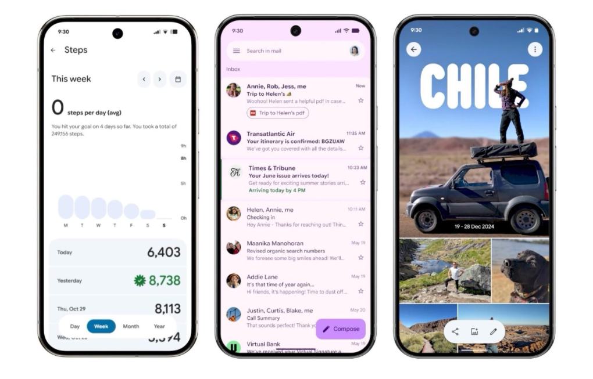](docs/assets/readme/01-phone-apps.png)

*Phone app screens showing activity, email, and photos.*

[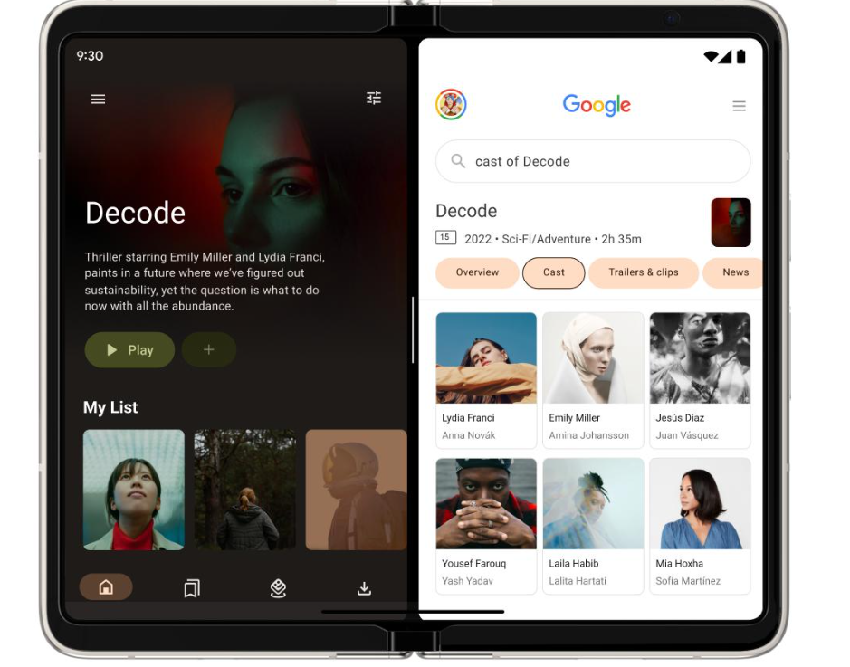](docs/assets/readme/02-foldable-entertainment-layout.png)

*Foldable entertainment layout with media and related content side by side.*

[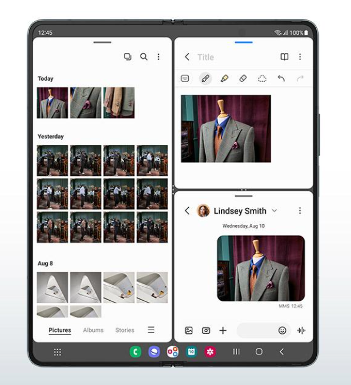](docs/assets/readme/03-foldable-multitasking-gallery.png)

*Foldable gallery and multitasking layout.*

[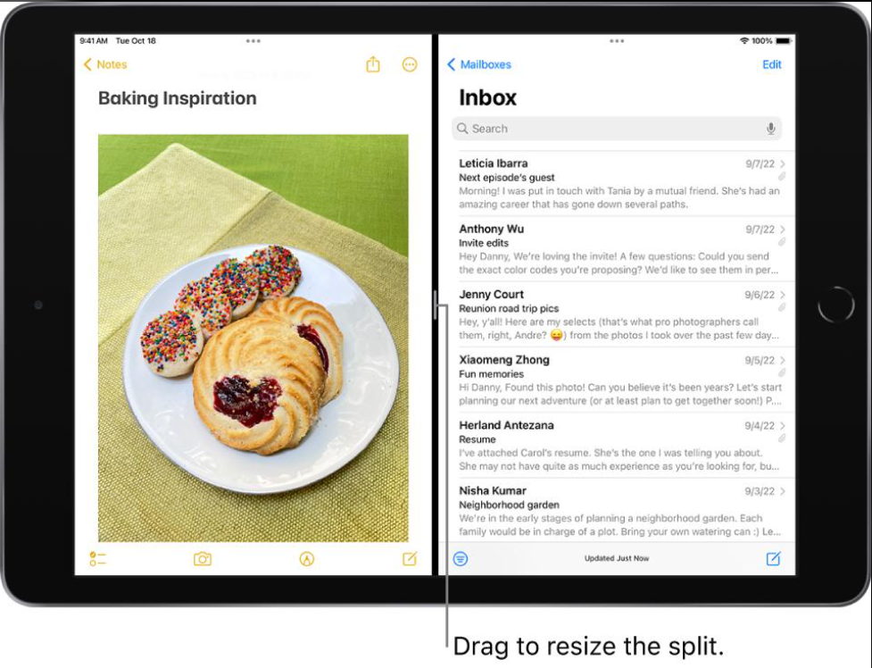](docs/assets/readme/04-ipad-split-view.png)

*Tablet split view with two apps and a draggable divider.*

[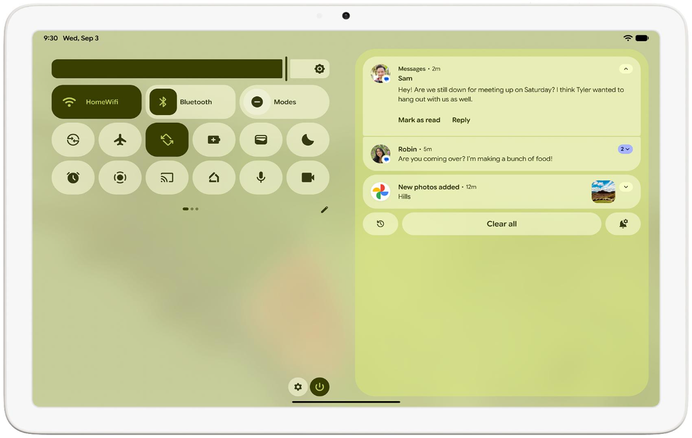](docs/assets/readme/05-android-tablet-notifications.png)

*Android tablet notifications and quick settings.*

Flutter's Material library implements Material Design components and theming. Setting `ThemeData.useMaterial3` selects Flutter's Material 3 behavior; it does **not** prove that every M3 Expressive component, motion treatment, or platform behavior is implemented. Use the [support matrix](docs/reference/support-matrix.md) and [component verification ledger](docs/reference/component-verification-ledger.md) to determine what is API verified, configurable, custom, platform-dependent, or unverified.

## Foundation examples

### Typography

[](https://m3.material.io/blog/building-with-m3-expressive)

*Official Material illustration; the article caption identifies the updated type scale and emphasized text styles. See the [source article](https://m3.material.io/blog/building-with-m3-expressive).*

Use typography as a hierarchy system, not a collection of arbitrary sizes. In Flutter, map the design roles to `TextTheme` entries and validate text scaling, long localization, and RTL flows. Exact expressive type-token values are not assumed unless the active Material source states them directly.

### Shape

[](https://m3.material.io/blog/building-with-m3-expressive)

*Official Material illustration; the article says its shape library includes 35 iconic shapes. See the [source article](https://m3.material.io/blog/building-with-m3-expressive).*

[](https://m3.material.io/blog/building-with-m3-expressive)

*Official Material shape illustration. Use it to recognize visual families, not to infer Flutter APIs or exact token values; see the [source article](https://m3.material.io/blog/building-with-m3-expressive).*

[](https://m3.material.io/blog/building-with-m3-expressive)

*Official Material expressive imagery example. See the [source article](https://m3.material.io/blog/building-with-m3-expressive) for context.*

[](https://m3.material.io/blog/building-with-m3-expressive)

*Official Material illustration. See the [source article](https://m3.material.io/blog/building-with-m3-expressive); do not treat the artwork as a reusable brand asset.*

For color roles, elevation, spacing, icons, motion, accessibility, and responsive design, use the [foundations guide](docs/foundations/index.md). Exact values are included only where the cited source supports them; unspecified values are not guessed.

## Component visual references

[](https://m3.material.io/blog/building-with-m3-expressive)

*Official Material example of expressive component styling. See the [source article](https://m3.material.io/blog/building-with-m3-expressive).*

The examples below are served from Google's Material Design hosting and link to the relevant official component guidance. They illustrate design intent; they are not Flutter renderings or proof of M3 Expressive parity.

### Buttons

[](https://m3.material.io/components/buttons/overview)

*Official Material image. Read the [buttons guidance](https://m3.material.io/components/buttons/overview).*

### Cards

[](https://m3.material.io/components/cards/overview)

*Official Material image. Read the [cards guidance](https://m3.material.io/components/cards/overview).*

### Navigation bar

[](https://m3.material.io/components/navigation-bar/overview)

*Official Material image. The page describes the Expressive navigation bar as shorter than the baseline. Read the [navigation bar guidance](https://m3.material.io/components/navigation-bar/overview).*

### Chips

[](https://m3.material.io/components/chips/overview)

*Official Material image. Read the [chips guidance](https://m3.material.io/components/chips/overview).*

### Additional mobile component and interaction references

The following ten maintainer-supplied images are preserved in this repository and summarized by the visible patterns they depict. Their original source and specification status have not been independently verified. Use them as visual inspiration only; confirm component anatomy, states, sizing, and behavior against the linked official guidance and the Flutter verification ledger before implementation.

[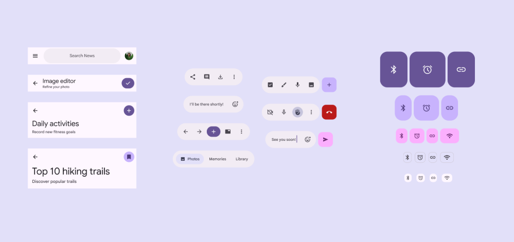](docs/assets/readme/13-expressive-quick-settings.png)

*Expressive quick settings, toolbar actions, and chips shown at different sizes.*

[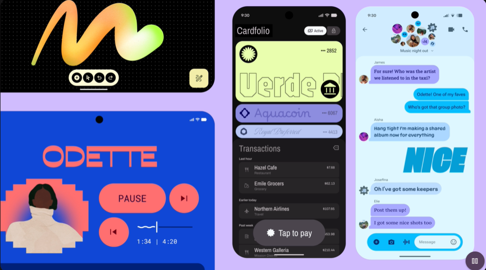](docs/assets/readme/14-expressive-mobile-apps-collage.png)

*Music, finance, and messaging interfaces showing varied color and composition.*

[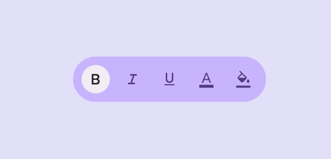](docs/assets/readme/15-rich-text-formatting-toolbar.png)

*Text formatting toolbar with bold, italic, underline, text-color, and highlight controls.*

[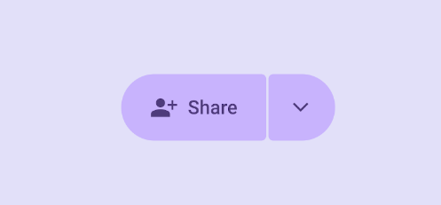](docs/assets/readme/16-share-split-button.png)

*Split share button with a primary action and a separate dropdown.*

[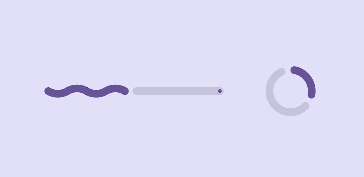](docs/assets/readme/17-slider-and-progress-indicators.png)

*Linear slider and circular progress indicator with expressive track treatments.*

[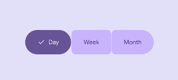](docs/assets/readme/18-segmented-time-selector.png)

*Segmented time selector for day, week, and month.*

[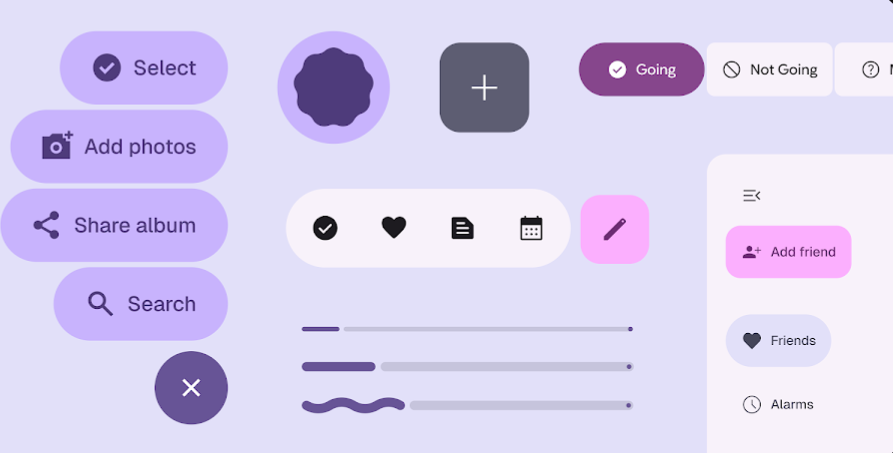](docs/assets/readme/19-expressive-actions-and-controls.png)

*Collection of expressive buttons, selection controls, sliders, and navigation actions.*

[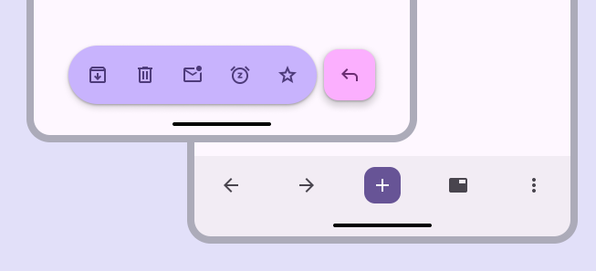](docs/assets/readme/20-foldable-bottom-action-bars.png)

*Bottom action bars shown across overlapping device panes.*

[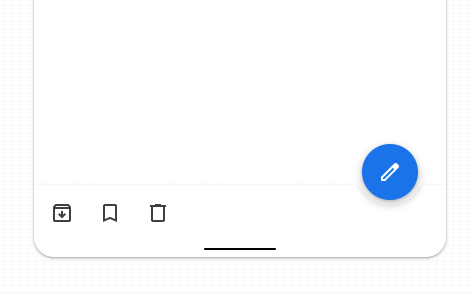](docs/assets/readme/21-mobile-floating-action-button.png)

*Floating edit action paired with a bottom row of content actions.*

[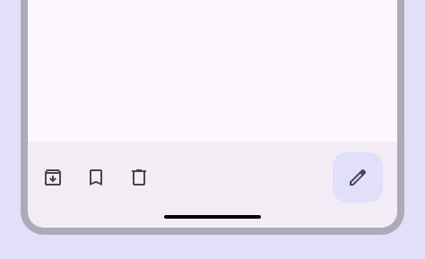](docs/assets/readme/22-mobile-bottom-action-bar.png)

*Mobile bottom action bar with archive, bookmark, delete, and edit actions.*

### Supplementary mobile app and interaction imagery

These maintainer-supplied images are additional visual references, not verified component specifications. Compare them with the relevant official Material pages before making implementation decisions.

[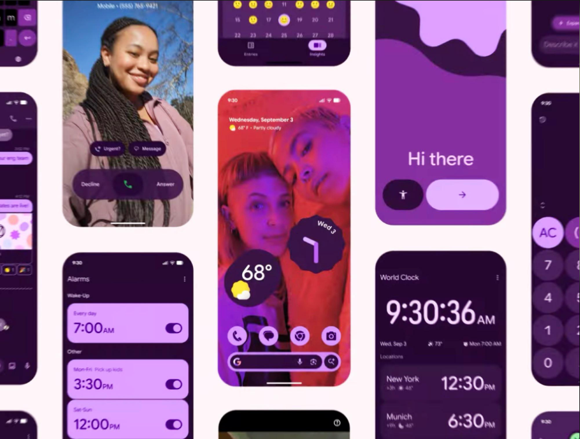](docs/assets/readme/06-expressive-mobile-apps.png)

*Expressive mobile app screens with varied layouts and color.*

[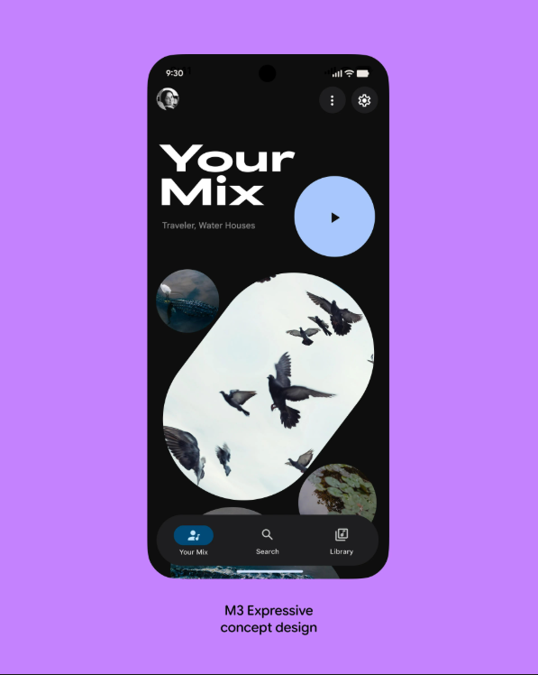](docs/assets/readme/07-mobile-music-player.png)

*Mobile music player screen.*

[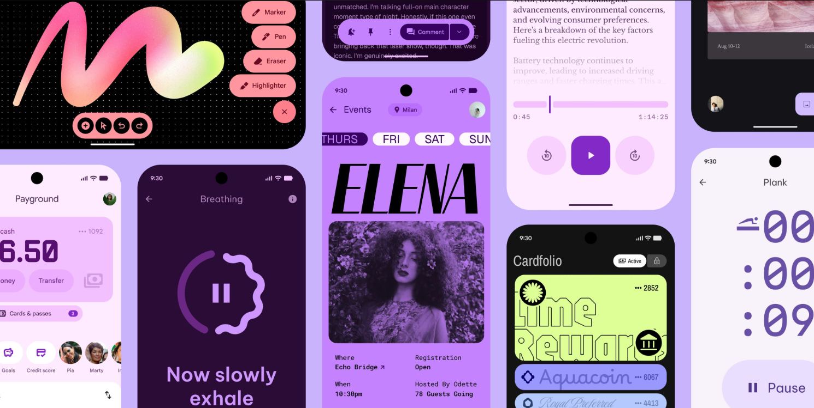](docs/assets/readme/08-expressive-app-gallery.png)

*Gallery of colorful expressive mobile app interfaces.*

[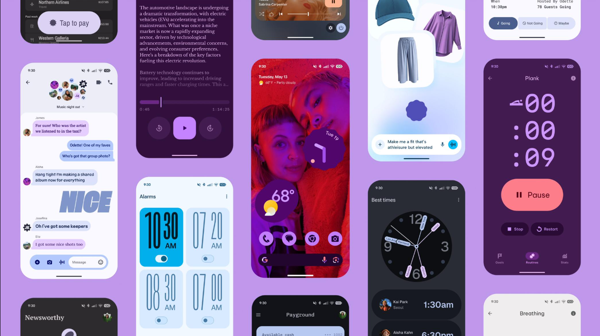](docs/assets/readme/09-mobile-interface-compositions.png)

*Mobile screen compositions with varied color and layout.*

[](docs/assets/readme/10-mobile-messaging.png)

*Mobile messaging inbox and conversation list.*

[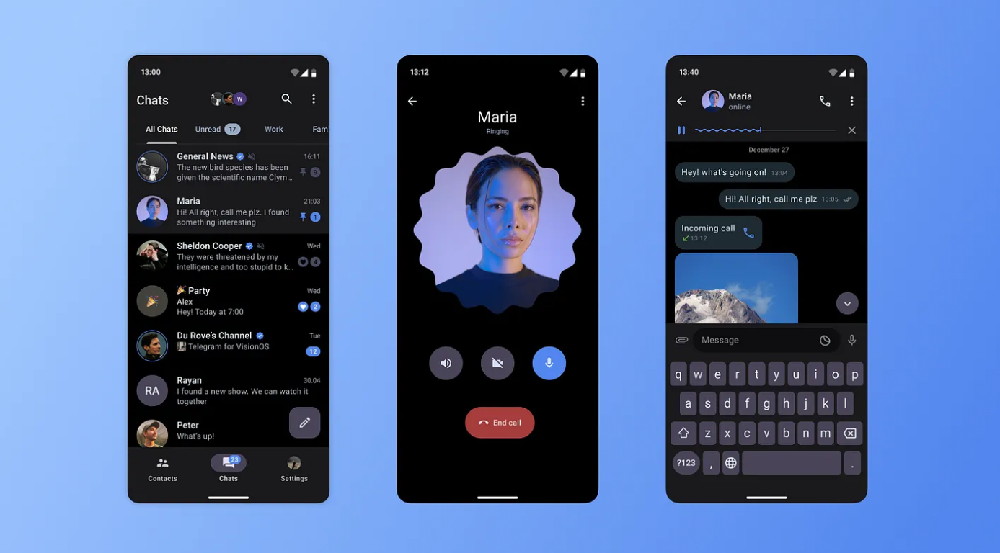](docs/assets/readme/11-mobile-chat-and-calls.png)

*Mobile chat, calling, and keyboard screens.*

[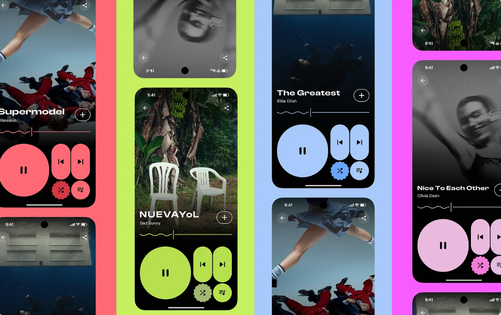](docs/assets/readme/12-expressive-music-controls.png)

*Expressive mobile music playback controls.*

[](https://m3.material.io/blog/building-with-m3-expressive)

*Official Material component illustration. Use it as visual context only; confirm component behavior and requirements in the relevant [component guide](docs/components/index.md) and [Flutter verification ledger](docs/reference/component-verification-ledger.md).*

For other component mappings, applicable states, Flutter SDK evidence, and visual-test gaps, see the [component catalog](docs/components/index.md), [component coverage matrix](docs/reference/component-coverage.md), and [verification ledger](docs/reference/component-verification-ledger.md).

The [Phase 0/1 audit](docs/reference/m3e-phase0-1-audit.md) records the documentation-readiness rubric and its limitations. Its [38-entry component inventory](docs/reference/m3e-master-component-inventory.csv) and [source-evidence ledger](docs/reference/m3e-source-evidence-ledger.csv) are audit artifacts, not M3E conformance claims.

## Start implementing

[](https://m3.material.io/components/navigation-bar/overview)

*Official Material component reference; Flutter support and appearance must be checked separately.*

1. Read [scope and terminology](docs/getting-started/scope.md), [support matrix](docs/reference/support-matrix.md), and [AI-agent instructions](AGENTS.md).
2. Identify the target Flutter version, platforms, input modes, localization/RTL needs, and accessibility requirements.
3. Follow the relevant foundation and component pages. Separate official Material guidance from Flutter API facts and repository recommendations.
4. Prefer built-in Flutter Material widgets when their verified behavior meets the requirement. Add custom work only for a documented gap.
5. Run the [validation checklist](docs/ai-agent-guide/validation-checklist.md) and applicable tests; report what was not tested.

```dart
MaterialApp(
  theme: ThemeData(
    useMaterial3: true,
    colorScheme: ColorScheme.fromSeed(
      seedColor: const Color(0xFF6750A4),
    ),
  ),
  home: const MyHomePage(),
)
```

This is a Material 3 Flutter starting point, not an M3 Expressive compliance recipe. Define light/dark schemes, typography, and component themes deliberately, then validate the implementation against the applicable guidance.

## Documentation and sample app

[](https://m3.material.io/components/cards/overview)

*Official cards visual reference; the repository's Flutter sample is a separate, non-normative implementation example.*

| Topic | Start here |
|---|---|
| Scope, evidence labels, and quick setup | [Getting started](docs/getting-started/scope.md) |
| Foundations | [Foundations index](docs/foundations/index.md) |
| Components | [Components index](docs/components/index.md) |
| Flutter architecture, theme, custom widgets, tests | [Flutter guide](docs/flutter/index.md) |
| Android and iOS mobile apps | [Platform guidance](docs/platforms/index.md) |
| Screen recipes | [Design recipes](docs/design-recipes/index.md) |
| AI coding-agent workflow | [AGENTS.md](AGENTS.md) and [agent guide](docs/ai-agent-guide/index.md) |
| Official source and visual references | [Source catalog](docs/reference/official-sources.md), [visual gallery](docs/reference/visual-reference-gallery.md) |
| Flutter sample app and official visual references | [Reference app](examples/flutter/reference_app/) |

## Build and validate

[](https://m3.material.io/components/buttons/overview)

*Official button visual reference. Use actual Flutter/platform captures as well as automated tests when validating a product.*

Build the documentation from the repository root:

```bash
python -m pip install -r requirements.txt
python scripts/validate_docs.py
python scripts/validate_links.py
mkdocs build --strict
```

Validate the standalone Flutter example from `examples/flutter/reference_app/`:

```bash
flutter pub get
flutter analyze
flutter test
```

Flutter widget-test goldens are regression fixtures for the test renderer, not Android or iOS device screenshots; see the [testing guide](docs/flutter/testing.md). No single automated test establishes accessibility or M3 Expressive conformance.

## Evidence, limitations, and image attribution

[](https://m3.material.io/components/chips/overview)

*Official Material image; open the [chips guidance](https://m3.material.io/components/chips/overview) for source context.*

Material's interactive pages may not expose every specification detail through text retrieval. The [source catalog](docs/reference/official-sources.md) and [component verification ledger](docs/reference/component-verification-ledger.md) state what was actually checked. Visuals and behavior still require review on intended Android and iOS devices, including relevant phone/tablet form factors, text scales, locales, touch input, and assistive technologies.

Official Material illustrations in this README are embedded from Google-hosted pages and link to their source pages; those files are not copied into this repository, and rights remain with their respective owners. Maintainer-supplied supplementary images are stored unchanged under [`docs/assets/readme/`](docs/assets/readme/) with permission from the project maintainer; their original sources and specification status have not been independently verified. Do not treat either group of images as Flutter screenshots or proof of conformance. See [Google Terms of Service](https://policies.google.com/terms) and the relevant Material source pages for current terms.

The original source list is preserved in [link_sources.md](link_sources.md) and the source catalog in [docs/reference/official-sources.md](docs/reference/official-sources.md). To report an inaccuracy or propose a source-backed change, follow [contribution guidance](CONTRIBUTING.md). The repository intentionally makes no claim of universal or 100% compliance.
